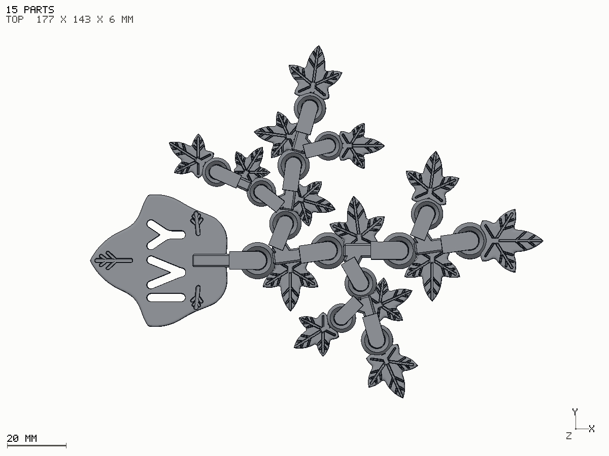
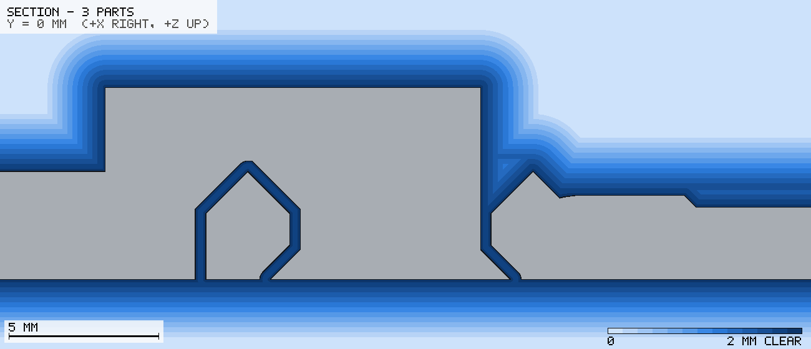

# Ivy's Vine

A print-in-place, articulated ivy vine with a name cut through its largest
leaf: a worked example of recursion, field operations and assembly mates in
the DSL. One colour of PLA, flat on the bed, no
supports, 15 parts that come off the plate already hinged together.



The whole design is one yapCAD DSL file, [ivy_vine.dsl](ivy_vine.dsl).

## What it is

- **A name leaf.** A broad, barely lobed leaf (the shape ivy grows once it is
  mature) with I, V and Y cut through it. Hold it by the leaf with the vine
  hanging down and the name reads the right way up; held to the light, the
  letters glow.
- **A vine that is a recursion.** `grow()` adds one link, then calls itself
  twice: once to continue the stem, and once, from the link's bud, to grow a
  whole smaller vine. Four stem links and two levels of side shoots give 14
  links at three sizes. Change `links` or `max_level` and a different vine
  grows.
- **Leaves whose veins are a recursion too.** `veins()` cuts a groove and,
  from two points along it, smaller pairs of grooves.
- **Fourteen hinges.** Each link is joined to its parent by a revolute mate
  on axis datums declared with `@meta(assembly.datums=[...])`, with limits
  from `set_mate_limits`.

## Where the signed distance fields earn their keep

The design is built with `representation="sdf"`, so every part is a field.

- **Leaf outlines are blends.** A leaf is five pointed lobes
  `smooth_union`ed together; the curved sinuses between lobes are the blend
  itself. One `fullness` number takes the same construction from the sharp
  five-lobed leaf of a climbing shoot to the broad name leaf.
- **A hinge's clearance is an offset.** The ring's bore is
  `offset_solid(pin, 0.35)` and the arch over the ring is
  `offset_solid(ring, 0.35)`: the gap is 0.35 mm measured normal to the
  surface everywhere, bevels included, with no arithmetic about cone angles.
- **Clearance is measured, not hoped for.** `yapcad.rom` poses the assembly
  from its own mates and measures part-to-part distance on the fields. The
  declared joint limits in the DSL are the ranges those sweeps found clear.

### The hinge



A pin whose foot flares at 45 degrees stops the ring sliding off downwards.
An arm over the top stops it lifting. The ring's top is a 45 degree ridge,
so the arch offset from it is a ridge as well and prints without a bridge.
Nothing is steeper than 45 degrees and nothing touches.

## Printing it

Slice `out/ivy_vine.stl` as it is: one object, flat, as
exported. Do not split it into parts or let the slicer re-arrange it.

| Setting | Value |
|---|---|
| Material | PLA |
| Nozzle / layer | 0.4 mm / 0.2 mm (0.16 mm also fine) |
| Supports | none |
| Brim | none (a brim would bridge the hinge gaps) |
| Walls / infill | 3 walls, 15 % |
| Elephant foot compensation | 0.15 mm |
| First layer | slow; a textured PEI plate hides the seam between parts |

The hinge gap is 0.35 mm, and it is tightest on the first layer, where each
pin's foot is widest. If a joint comes off the plate stuck, flex it gently
side to side and it will free. If first layers on this machine run fat,
raise `gap()` in the DSL to 0.40 and rebuild.

The parts are chunky and nothing detaches, but a 6 mm PLA hinge arm will
break if it is bent hard out of plane.

## Building it

From this directory, with yapCAD installed (numpy is enough; `check_print.py`
and the STL export also want `trimesh`):

```bash
PY=python

$PY -m yapcad.dsl check ivy_vine.dsl
$PY build_vine.py --quick          # ~3 min: pictures, clearances, sweeps
$PY build_vine.py --step 5         # ~17 min: the same, plus out/ivy_vine.stl
$PY check_print.py out/ivy_vine.stl
```

`build_vine.py` only drives the DSL. It runs `IVY_VINE` deferred, so the
15-part assembly builds as fields in under a second; measures the as-printed
clearance of every pair of parts; sweeps each joint across its declared
limits; sphere-traces the pictures; and only then meshes the parts, in
parallel, to write the STL. Nearly all of the full build's time is
simplifying those meshes against their fields.

Single parts can be looked at directly:

```bash
$PY -m yapcad.render ivy_vine.dsl VINE_LINK --param level=1 --view 4up -o link.png
$PY -m yapcad.render ivy_vine.dsl NAME_LEAF --view top -o name_leaf.png
```

## Results of the last full build

`build_vine.py` writes the full numbers to `out/ivy_vine_report.json`.

| Check | Result |
|---|---|
| Size | 152.7 x 119.1 x 6.4 mm, 16.6 cm^3 (about 21 g of PLA solid) |
| STL | 121,668 triangles in 15 watertight bodies, every one on the bed |
| As-printed clearance | every pair of parts apart; the closest are the hinges themselves |
| Hinge gap | 0.35 mm by construction; measured at least 0.28 mm (0.08 mm sampling, a lower bound) |
| Joint sweeps | all 14 joints clear at every 5 degree step of their declared limits |
| Stem joints | +/- 48 degrees; side shoots 55 to 135 degrees from their parent stem |
| Overhang past 45 degrees, off the bed | 37 mm^2 in total: a 0.5 mm strip at the crown of each hinge arch |

The clearance figures in the report read lower than the 0.35 mm design gap
(+0.08 to +0.18 mm). They are lower bounds: hard CSG fields under-report
distance, and the sweeps sample at 0.2 to 0.25 mm. Their sign is what the
check is for, and it is positive everywhere.
